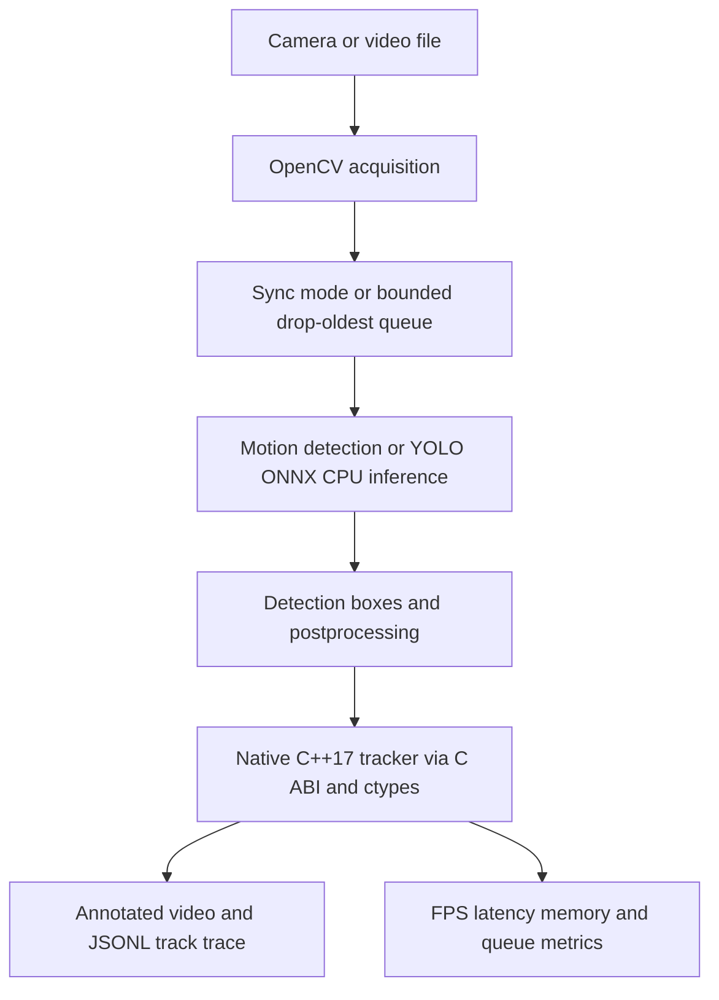

# EdgeVision — Real-time video perception on CPU

An independent, AI-assisted engineering portfolio project combining Python, OpenCV, YOLO11n / ONNX Runtime, and native C++17 object tracking. Tested on Linux and an Apple Silicon MacBook Air. It is a single-camera engineering prototype, not a production robotics deployment or a product of Complex System Inc.

[Technical portfolio (PDF)](docs/EdgeVision_Technical_Portfolio.pdf) · [Architecture](ARCHITECTURE.md) · [Test plan](TEST_PLAN.md) · [Acceptance criteria](ACCEPTANCE.md) · [Benchmark evidence](evidence/paired_summary.json)

## Measured performance

Controlled offline benchmark: identical 300-frame unannotated input video, identical ONNX model weights and settings, three runs per version. Results are median values from the operator-supplied benchmark summary.

| Metric | v0.9 | v0.10 |
|---|---:|---:|
| Full throughput including video I/O | 26.19 FPS | **45.61 FPS** |
| Processing throughput excluding I/O | 27.89 FPS | 52.74 FPS |
| Processing latency p95 | 39.762 ms | **21.504 ms** |
| Postprocessing median | 18.687 ms | **0.888 ms** |
| Peak sampled RSS | 251.64 MB | 262.42 MB |

**74% higher full throughput, 46% lower processing p95 and 21x faster median postprocessing.** Vectorized YOLO candidate filtering preserves the tested NMS and coordinate contracts. See [optimization report](OPTIMIZATION_V010.md).

Separate live camera runs achieved 18.07 and 29.38 FPS respectively; the scenes differed, so this is not a controlled comparison. v0.10 discarded 6 of 308 captured frames due to software queue overflow. Hardware drops and sensor-to-display latency were not measured.

## Architecture



## Engineering evidence

- 81 automated tests passed on the latest Linux source recheck ([log](evidence/linux_recheck.txt)). 67 tests passed on macOS v0.9; a v0.10 macOS test-count result was not independently supplied.
- Physical MacBook Air camera, genuine CPU ONNX inference, and v0.10 live and paired offline runs verified by the project operator.
- Native C++17 build, C ABI integration, transactional tracker update safety, bounded capture, source sequence IDs, monotonic host timestamps, software drop accounting and per-frame track audit.
- Original Git history records iterative requirements, regression tests, fixes and optimization. Earlier milestone documents may contain superseded verification statuses.

## Reproduce

Linux, with Python 3.13 and a C++17 compiler:

```bash
python3 -m venv .venv
source .venv/bin/activate
python -m pip install -r requirements.txt
bash scripts/build.sh
python -m pytest -q
bash scripts/verify_release.sh
```

For macOS, see [setup instructions](MACOS_SETUP.md). For optional semantic detection, install `requirements-onnx.txt` and supply a compatible local raw YOLO ONNX export as described in [ONNX setup](ONNX_MACOS.md) and [model contract](ONNX_CONTRACT.md).

```bash
python -m edgevision --source 0 --detector onnx \
  --model models/yolo11n.onnx --capture-mode buffered \
  --queue-capacity 3 --max-frames 300 \
  --output artifacts/camera.avi --metrics artifacts/camera.json \
  --tracks-jsonl artifacts/camera_tracks.jsonl
```

The paired benchmark script is in `benchmarks/edgevision_paired_benchmark.py`. It compares two installed versions using the same raw video and model. Historical raw footage and individual run logs are not published, so the exact historical experiment cannot be independently replayed from this repository alone; the procedure can be repeated on new footage. Model weights are not included; review the upstream license before use or redistribution.

## Scope and further validation

Not a hard-real-time or production-certified system. No labeled real-world detection accuracy or ID-switch benchmark, hardware sensor-to-display latency, Jetson deployment, ROS or drone-control integration is claimed. Docker runtime and hosted CI are not yet verified. Potential next steps, if required: long-duration memory/thermal stress, camera reconnect, labeled detection/tracking evaluation, hardware acceleration and Linux/ARM target-device benchmarking.
