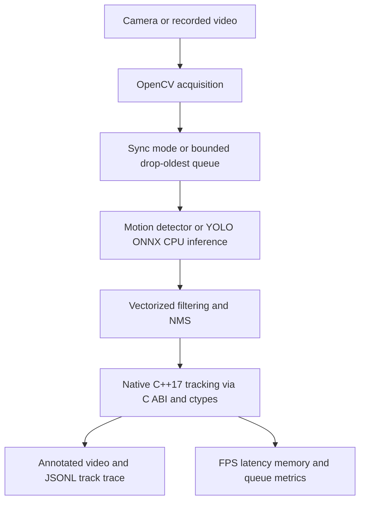

# EdgeVision — Real-time video perception on CPU

Independent, AI-assisted engineering portfolio project. Python, OpenCV, YOLO11n / ONNX Runtime and a native C++17 tracking engine. Built and evaluated on Linux and an Apple Silicon MacBook Air. Not a production robotics system or a CSI product.

## Measured results

Controlled offline benchmark: identical 300-frame raw video, identical ONNX model weights and settings, three runs per version. Values are medians of the reported runs.

| Metric | v0.9 | v0.10 |
|---|---:|---:|
| Full throughput including video I/O | 26.19 FPS | **45.61 FPS** |
| Processing throughput excluding I/O | 27.89 FPS | 52.74 FPS |
| Processing latency p95 | 39.762 ms | **21.504 ms** |
| Postprocessing median | 18.687 ms | **0.888 ms** |
| Peak sampled RSS | 251.64 MB | 262.42 MB |

**74% higher full throughput, 46% lower processing p95 and 21x faster median postprocessing.** The optimization vectorizes YOLO candidate filtering while retaining the original NMS and coordinate contracts.

Separate live camera runs achieved 18.07 and 29.38 FPS respectively; scenes differed, so these are not a controlled comparison. v0.10 dropped 6 of 308 captured frames due to software queue overflow.

## Architecture

## Engineering and validation

- Architecture and acceptance contracts, test-first regression cycles and native ABI safety.
- 81 automated tests passed on the latest Linux source recheck; 67 passed on macOS v0.9.
- Physical camera and genuine CPU ONNX inference verified on MacBook Air, including successful v0.10 live and paired offline runs.
- C++ native sanitizer smoke test passed in the local environment.
- Bounded frame buffering, source sequence IDs, monotonic host timestamps, overflow accounting and per-frame track audit.

## Limitations and next steps

This is a single-camera perception prototype, not a production or hard-real-time robotics deployment. No measured detection accuracy on labeled real-world scenes, no hardware sensor-to-display latency, no Jetson deployment, no ROS or drone control integration. Docker runtime and hosted CI remain unverified. Longer stress tests, camera reconnect, labeled tracking evaluation and target-device benchmarking are possible next steps if required.

Raw personal footage and model weights are intentionally excluded. Historical benchmark footage and individual run logs are not published, so the exact historical trial cannot be independently replayed from the public repository alone.

**Publication status:** engineering summary is available now; full source, original Git history, technical report and supporting files are pending import.
